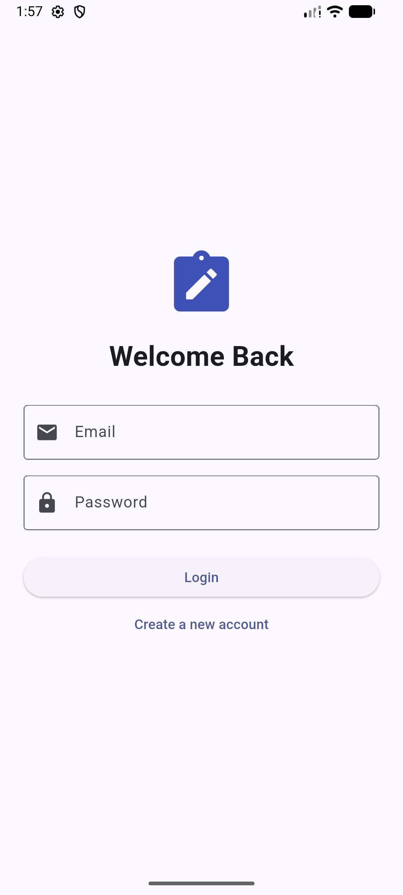
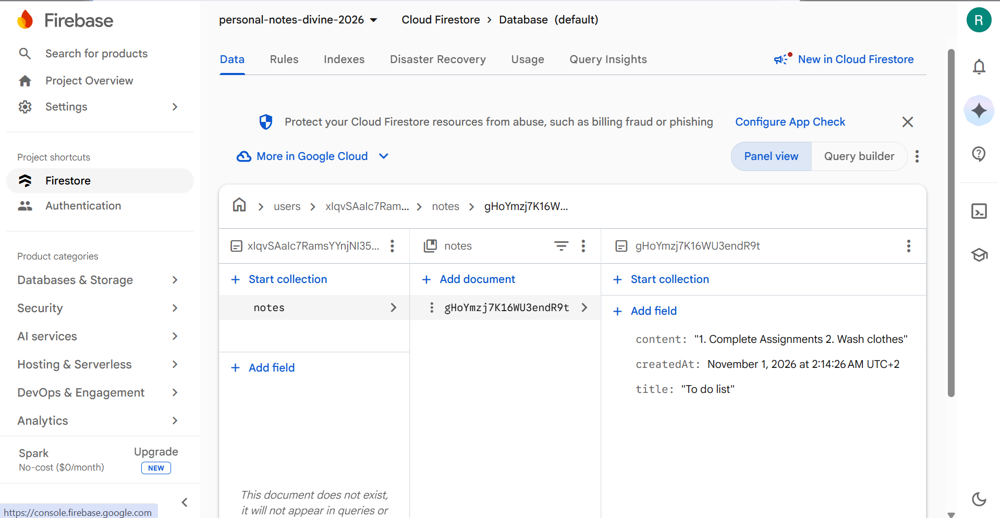
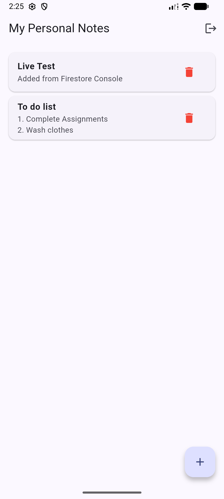
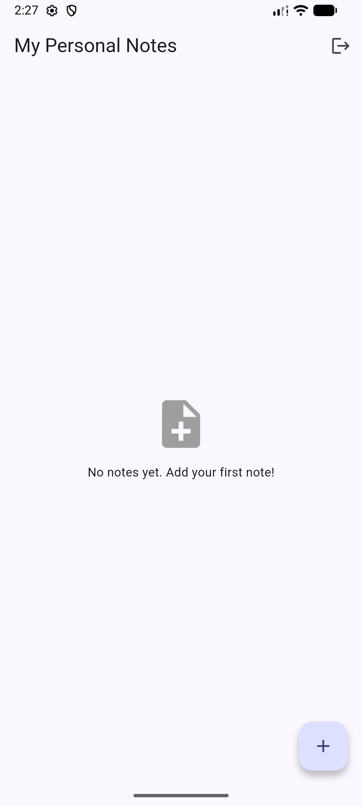

# Personal Notes App

## Overview

Personal Notes App is a Flutter application that allows users to create, view, edit, and delete personal notes. The app uses Firebase Authentication to manage user accounts and Cloud Firestore to store notes securely.

Each user's notes are saved under their unique Firebase Authentication user ID. This ensures that users can only access their own notes. The app also uses real-time Firestore updates, so changes appear automatically without restarting the application.

## Features

* **User Authentication:** Users can create an account and log in using an email address and password.
* **Personal Notes:** Users can create notes with a title and content.
* **Edit Notes:** Users can update existing notes.
* **Delete Notes:** Users can remove notes they no longer need.
* **Real-Time Updates:** Changes in Firestore appear in the app automatically.
* **User Data Privacy:** Each user's notes are stored separately under their own user ID.

## Technologies Used

* Flutter and Dart for application development.
* Firebase Authentication for account registration and login.
* Cloud Firestore for storing and synchronizing notes.

## How Data Is Stored

Notes are stored in Cloud Firestore using the following structure:

`users/{userId}/notes/{noteId}`

The `userId` is the unique ID assigned to the signed-in user by Firebase Authentication. Each note is stored as a document within that user's `notes` subcollection.

Firestore security rules require users to be authenticated and restrict access to their own data.

## Screenshots

### Login Screen

### Notes Stored in Firestore

### Real-Time Update

### Second Account Privacy Test

